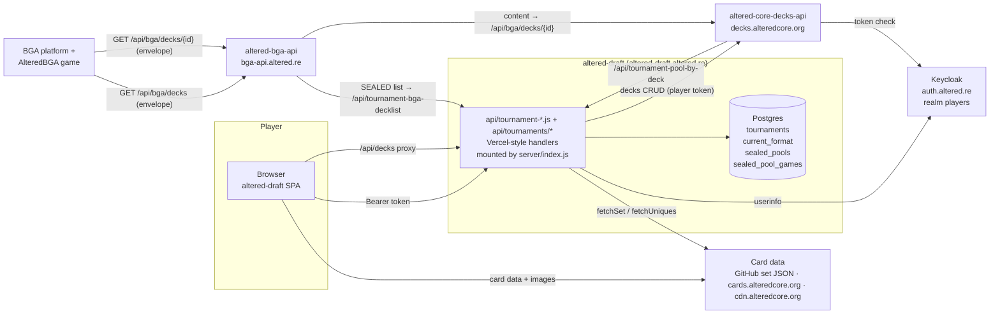
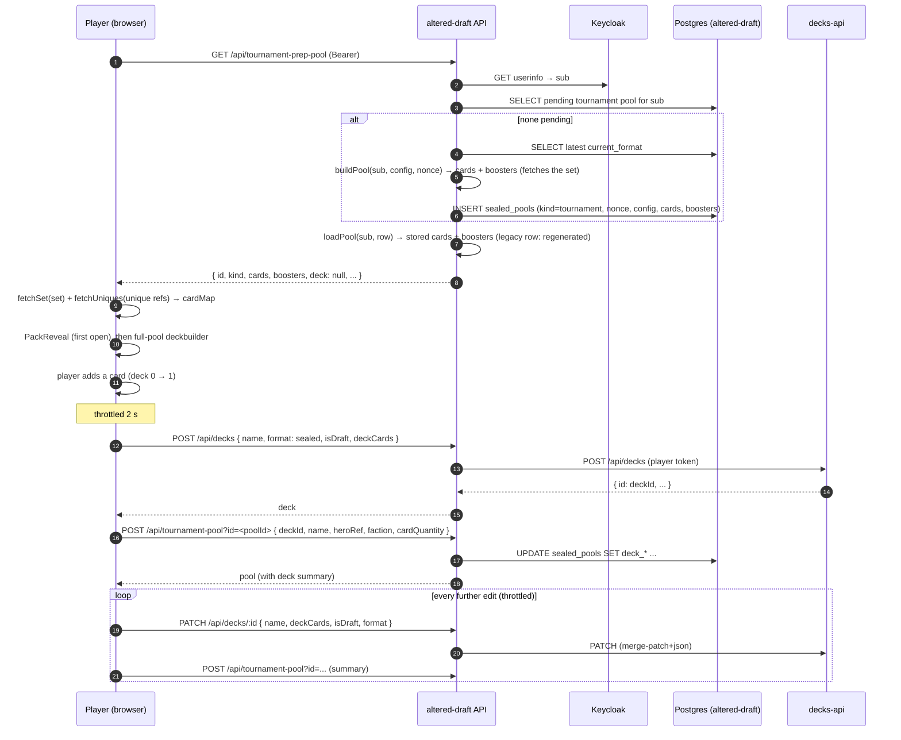
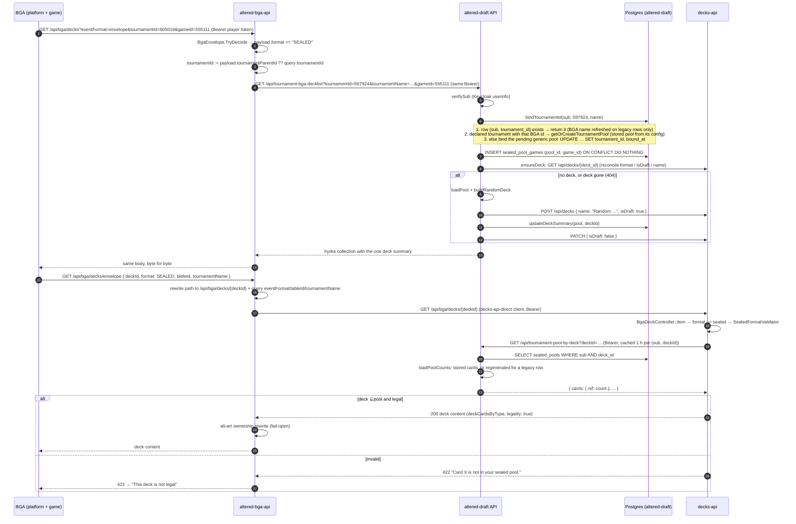
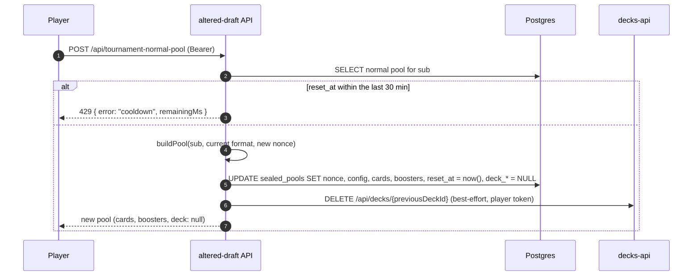
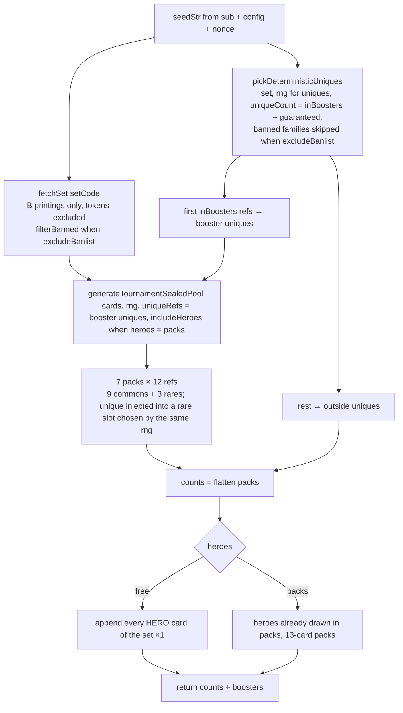
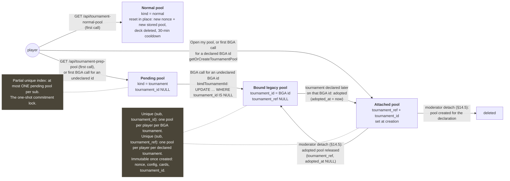
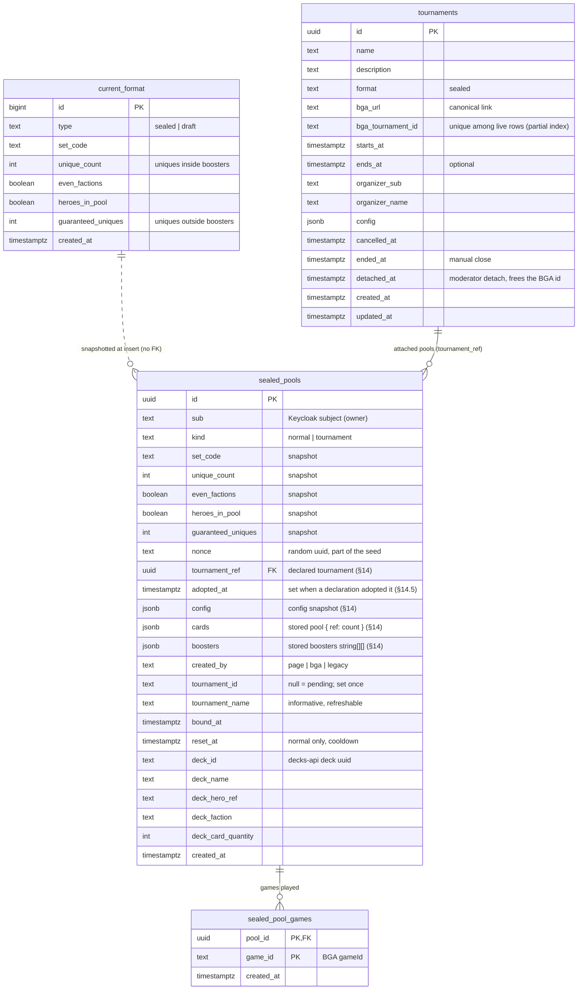

# Sealed tournaments on BGA — feature documentation

> Audience: AI assistants and developers working on the tournament feature across
> **altered-draft**, **altered-bga-api** and **altered-core-decks-api**.
> Written against the code as of 2026-10-18 (altered-draft branch `feat/user-tournaments`,
> altered-bga-api `main` at "Shift Stage 1 group parent to the tournament root", AlteredBGA
> `main` at `19beb5f2`).
> A developer-oriented HTML rendering of the same content lives next to this file
> (`index.html`).

Table of contents

1. [What the feature is](#1-what-the-feature-is)
2. [Functional description](#2-functional-description)
3. [Architecture](#3-architecture)
4. [Pool generation: determinism and composition](#4-pool-generation-determinism-and-composition)
5. [Pool lifecycle and tournament binding](#5-pool-lifecycle-and-tournament-binding)
6. [Deck synchronisation and naming conventions](#6-deck-synchronisation-and-naming-conventions)
7. [Database schema](#7-database-schema)
8. [Code map and responsibilities](#8-code-map-and-responsibilities)
9. [API contracts and exchanged data](#9-api-contracts-and-exchanged-data)
10. [Configuration, environments, deployment](#10-configuration-environments-deployment)
11. [Local development and testing](#11-local-development-and-testing)
12. [Invariants, pitfalls, and how to extend](#12-invariants-pitfalls-and-how-to-extend)
13. [History and design decisions](#13-history-and-design-decisions)
14. [User-created tournaments (lot 1)](#14-user-created-tournaments-lot-1)
15. [Glossary](#15-glossary)

---

## 1. What the feature is

Re:Union runs **online sealed tournaments** of the Altered TCG. The tournament itself
(pairings, rounds, results) lives on **BoardGameArena (BGA)**. The sealed part — opening a
pool of boosters and building a deck from it — lives on **altered-draft**
(`https://altered-draft.altered.re`). When a BGA game starts, BGA asks for the player's
deck through **altered-bga-api** (`https://bga-api.altered.re`), which answers the
sealed-format deck LIST straight from altered-draft, while the deck CONTENT still comes
from **altered-core-decks-api** (`https://decks.alteredcore.org`), which validates the deck
against the player's pool by calling altered-draft back.

Two ways a sealed configuration is chosen:

- **Declared tournaments** (§14): an organizer declares a BGA tournament on altered-draft with
  its own configuration (7 boosters of one set, heroes, uniques, ban list). Its players get
  a pool built from that configuration.
- **The current competitive format** (a row in `current_format`, seeded by
  `sealed-pools-schema.sql`) for the two generic flows: the casual "normal" pool and the
  "prepare my next tournament" pool used for BGA tournaments nobody declared.

The seeded current format:

| Field | Value | Meaning |
| --- | --- | --- |
| `type` | `sealed` | Only sealed is supported; draft is explicitly deferred. |
| `set_code` | `EOLE` | Set 6, *Roots of Corruption*. |
| `unique_count` | `1` | One unique **inside** the boosters (replaces a rare slot). |
| `guaranteed_uniques` | `1` | One extra unique handed out **outside** the boosters. |
| `even_factions` | `false` | Uniques drawn freely across factions. |
| `heroes_in_pool` | `false` | Heroes are not opened in boosters; **every hero of the set is appended to the pool** instead. |

So a pool of the current format is **7 boosters of 12 cards** (9 commons + 3 rares, one of the 21 rare
slots swapped for a unique) **+ 1 guaranteed unique + all EOLE heroes**.

The two cheating vectors and how the design kills them:

- **Re-rolling** a sealed pool until it is good → **one-shot commitment**: a player gets
  exactly one pool per declared tournament (unique `(sub, tournament_ref)`), and can hold
  only one *pending* generic tournament pool at a time, unlocked (a new one becomes mintable)
  only once a real BGA tournament binds to it.
- **Playing cards outside the pool** → **server-side validation**: the pool is generated once
  from a seed and **stored** on the row (`cards`, `boosters`); decks-api checks
  `deck ⊆ pool` against it before handing deck content to BGA. An invalid deck is rejected outright (HTTP 422), which BGA
  surfaces as "This deck is not legal".

Out of scope / not built: draft tournaments, a signed attestation (the
`SEALED_ATTESTATION_SECRET` env var is provisioned on AlteredOps but **unused by any code**),
an end signal for BGA tournaments nobody declared (declared ones have an end date and a
manual close), automated cleanup of old pools.

---

## 2. Functional description

### 2.1 Actors

| Actor | Role |
| --- | --- |
| Player | Has a Re:Union account (Keycloak, realm `players`). Logs into altered-draft with it. |
| Organizer | Any logged-in player who declares a tournament (§14). Edits, cancels, closes or deletes the tournaments they declared; at most 10 open at a time. |
| Moderator | Organizer powers on every tournament, no creation limit, plus **detach** (§14.5). A Keycloak realm role (`TOURNAMENT_MODERATOR_ROLE`) and/or an allowlist of subs (`TOURNAMENT_MODERATORS`). |
| altered-draft | Declared tournaments (`tournaments`), pool generation and storage, the deckbuilder; owns all tournament state (`sealed_pools`). |
| altered-core-decks-api | Stores the actual deck (card list) under the player's Re:Union account. Validates sealed decks. |
| altered-bga-api | Gateway in front of decks-api for BGA. Short-circuits the sealed deck LIST to altered-draft. Also ingests end-of-game stats (separate feature). |
| BGA (AlteredBGA game code + BGA platform) | Runs the tournament and the games. The game code (PHP, `modules/php/States/SetupTrait.php`) builds the envelope and calls BGA's platform proxy, which forwards to altered-bga-api with the player's bearer token and appends `tournamentId`/`gameId`. The game client (`altered.js`) drives the sealed-specific screens. |
| Keycloak (`auth.altered.re`) | Identity. Every tournament endpoint verifies the player's bearer token against Keycloak's userinfo. |
| Card data sources | Set files from the PolluxTroy0 GitHub DB, uniques from `cards.alteredcore.org`, images from `cdn.alteredcore.org`. |

### 2.2 Pages in altered-draft

All tournament pages require a Re:Union login, except the public list of declared tournaments
(`/tournament`) and a tournament's page (`/tournament/t/:id`). Logged-out visitors get a
"Connect" button that returns them to the same page after login.

| Route | Page component | What the player sees |
| --- | --- | --- |
| `/` | `Home.jsx` | A **"Sealed set 6"** block with two image buttons: **Tournaments** (→ `/tournament`) and **Normal mode** (→ `/tournament/normal`). |
| `/tournament` | `TournamentMenu.jsx` | Header (title, "Create a tournament", BGA registration notice); **"My ongoing tournaments"** (logged in, when any): a grid of the started tournaments the player has a pool in, each card opening the tournament page with a direct "Change my deck" button; then **tabs**, each with a one-line explanation, the active one kept in the URL (`?tab=upcoming|ongoing|pools|created`): **Upcoming** (default, public), **Ongoing** (public: pools can still be prepared until the end), **My pools** (every bound pool, declared tournaments first; a card opens the tournament page, or the pool itself for a BGA tournament nobody declared, plus "Change my deck"), **My created tournaments** (`GET /api/tournaments?mine=1`, every status, grouped: ongoing then upcoming, each chronological, then a folded "Ended and cancelled (N)" block with the ended, cancelled and detached ones). The two personal tabs show a Connect box when logged out. **Below the tabs**, whatever tab is open, the generic "Tournament not listed here?" block: its button opens `/tournament/prep` (login first when logged out) and reads "Prepare my next tournament", or "See my pool and deck for my next tournament" once the player has a pending prep pool (`pending` from `GET /api/tournament-bound-pools`). |
| `/tournament/new` | `TournamentForm.jsx` | Declare a tournament (§14). |
| `/tournament/t/:id` | `TournamentDetail.jsx` | A declared tournament: description, dates, 3-step checklist, organizer panel (§14). Public. |
| `/tournament/t/:id/edit` | `TournamentForm.jsx` | Edit a declared tournament (organizer / moderator). |
| `/tournament/t/:id/pool` | `TournamentPoolPage.jsx` → `TournamentPoolView` | The player's pool for a declared tournament (get-or-create). |
| `/tournament/prep` | `TournamentPrep.jsx` → `TournamentPoolView` | The player's single *pending* tournament pool. **No reset button**: this is the one-shot commitment. |
| `/tournament/normal` | `TournamentNormal.jsx` → `TournamentPoolView` | The player's single casual pool (for non-tournament BGA sealed games). Has a **"Reset pool"** button with a **30-minute cooldown** (live countdown). |
| `/tournament/pools/:id` | `TournamentBoundDetail.jsx` → `TournamentPoolView` | One bound tournament pool, to edit the deck between games. Title = the tournament name. |
| `/edit/deck/:deckId` | `EditDeckRedirect.jsx` | Deep link from a decks-api deck id (e.g. surfaced by BGA or altered.re). Resolves the caller's own pool for that deck and redirects to `/tournament/normal` or `/tournament/pools/:id`. Unknown or foreign deck → "Deck not found". |

`TournamentPoolView.jsx` is the shared pool + deckbuilder screen:

- **First-open pack reveal** (`PackReveal.jsx`): a full-screen overlay that walks through the
  7 boosters, then an **8th "booster" holding the guaranteed unique**. Shown once per pool
  (localStorage key `pool_reveal_seen:<poolId>:<resetAt>`), skippable (button or Escape).
  Images are preloaded per pack so cards appear only when ready.
- **Full-pool deckbuilder** (`PoolGrid`): every card of the pool with +/- controls, filters,
  grouping. Heroes appear in the full pool, not in any booster.
- **Validity badge**: `≥ 30 cards`, `≤ 3 factions`, `≤ 1 hero` → "Valid" / "Not valid".
- **"Random deck"** (only when the deck is empty): builds a 30-card, ≤3-faction, 1-hero deck
  from the pool (`randomDeck.js`).
- **"Reset deck"** (with confirmation) empties the deck; the pool is untouched.
- **"Reset pool"** (normal mode only): new pool, deck deleted, 30-minute cooldown.
- **Background deck sync**: as soon as the deck is non-empty, a deck is created on decks-api
  and kept in sync on every change, throttled to one call per 2 s. See §6.

### 2.3 Player journeys

**Declared tournament journey** (§14)

1. An organizer declares the tournament on `/tournament/new` with the BGA link and its
   sealed configuration. It shows in the public "Upcoming" list of `/tournament`.
2. The player opens the tournament page (`/tournament/t/:id`) and follows its checklist:
   register on BGA (remembered in the browser, BGA registration can't be verified) → **Open
   my pool** (one stored pool per player, built from the tournament's config, created
   **pre-bound** to the tournament's BGA id) → build the deck (synced to decks-api).
3. When a game starts, the BGA deck-list call lands on that pool directly (§14.2). A player
   who never opened altered-draft gets the pool created by that first call, with a random
   deck, like in the generic journey below.

**Generic tournament journey** (BGA tournaments nobody declared)

1. The player opens `/tournament/prep` any time before the tournament. A pending pool is
   minted on first visit and stays locked. They build a deck; it is saved under their
   Re:Union account as a `sealed`-format deck.
2. They register to the tournament on BGA. The BGA schedule is the start of the rounds, so
   the deck has to be built before.
3. The first game of the tournament starts. BGA asks altered-bga-api for the player's deck
   list with `format: SEALED` and the tournament id. altered-bga-api calls altered-draft,
   which **binds** the pending pool to that tournament id (one-time write), records the game,
   and returns the linked deck summary. If the player never built a deck, altered-draft
   **mints a random legal deck** named `Random …` so the game can still start.
   On the BGA side the sealed format skips the preconstructed-deck wizard and goes straight
   to the fetch flow; the single returned deck is auto-selected. A name starting with
   `Random` shows a warning ("You didn't build your deck before the matches started…"); a
   name starting with `Invalid` stops there with a link to fix the deck on altered-draft; an
   empty list shows "No Sealed deck found" with a link to altered-draft.
4. From then on the pool appears under **"My pools"**, and a *new* pending pool
   is available for the next tournament. The player may edit the bound deck between games;
   every BGA deck-content fetch re-validates it against the pool.
5. BGA fetches the deck content through altered-bga-api → decks-api. decks-api validates
   `deck ⊆ pool` by asking altered-draft for the pool linked to that deck id. Invalid → 422 →
   BGA shows "This deck is not legal".

**Normal (casual) journey**

The same screen, but for non-tournament BGA sealed games. A BGA deck-list call **without** a
tournament id resolves to the player's normal pool. The player can reset the pool every 30
minutes; resetting deletes the linked deck on decks-api (best-effort) so decks-api never
validates against a stale pool.

### 2.4 Interactions with other Re:Union surfaces

- **altered.re / deckbuilder.alteredcore.org**: the synced deck is a regular deck in the
  player's account (`format: sealed`, `isDraft` reflecting validity). Editing it there goes
  through decks-api's generic save, which validates against the pool too (by deck id).
  decks-api refuses to change a deck's format to/from `sealed`.
- **BGA**: only through altered-bga-api (§9.2). The BGA table option "Deck format =
  Sealed" (option 155, value 7, `OPTION_DF_SEALED` in AlteredBGA) selects the format; its
  description tells players decks must be built on altered-draft.altered.re. The BGA client
  links to `https://altered-draft.altered.re/edit/deck/<deckId>` ("change your deck between
  games", "fix it"), which is the `/edit/deck/:deckId` deep link above.
- **End-of-game stats** (altered-bga-api `POST /games/register`): a separate feature that
  stores games per BGA tournament id. Not wired to sealed pools today, but it keys on the
  same BGA tournament ids (`Tournaments.TournamentId` / `TournamentParentId`) that
  `sealed_pools.tournament_id` stores, so a join is possible later.

### 2.5 Known functional limits

- "My pools" only grows: pools are never archived. Declared tournaments show their
  status (upcoming / ongoing / ended / cancelled) next to the pool; generic ones have none.
- Validity differs slightly between altered-draft (`≤ 1` hero) and decks-api (`exactly 1`
  hero). A 30-card deck with no hero shows "Valid" in the app but is rejected by decks-api
  and therefore by BGA. See §12.
- The pool contents are visible to the player before the tournament; this is by design
  (only the validated deck counts).

---

## 3. Architecture

### 3.1 Components



### 3.2 State ownership

| State | Owner | Where |
| --- | --- | --- |
| Declared tournaments (name, BGA id, dates, organizer, config, status timestamps) | altered-draft | `tournaments` |
| Active competitive format (generic flows) | altered-draft | `current_format` (append-only) |
| Per-player pools (nonce, config snapshot, **stored cards + boosters**, binding, deck summary) | altered-draft | `sealed_pools` |
| Games played per pool | altered-draft | `sealed_pool_games` |
| The deck itself (card list, name, isDraft, legality) | decks-api | `Deck` / `DeckCard` entities |
| Identity | Keycloak | `sub` claim; altered-draft stores `sub` as the owner key |
| Deck editor state in the browser | altered-draft frontend | React state; seeded from decks-api on load (no localStorage for tournament decks) |
| Pack-reveal "seen" flag | browser | localStorage `pool_reveal_seen:<id>:<resetAt>` |
| Tournament metadata (name, parent, group) + games + player results | altered-bga-api | `Tournaments`, `Games`, `PlayerGames` (end-of-game feature) |

altered-draft **stores the pool's card list** (`sealed_pools.cards` = `{ ref: count }`,
`boosters` = the 7 packs), generated once when the row is created (§4). Rows created before
that change are regenerated from their seed until `scripts/freeze-sealed-pools.mjs` stores
them. The **deck's** card list is never stored here: only a summary (id, name, hero, faction,
card count); the deck lives on decks-api.

### 3.3 Sequence: preparing a pool and building a deck

The same flow for a declared tournament goes through `GET /api/tournaments/:id/pool`
(`getOrCreateTournamentPool`, config from the `tournaments` row); see §14.



### 3.4 Sequence: a BGA game starts (deck list → binding → deck content → validation)



### 3.5 Sequence: resetting the normal pool



---

## 4. Pool generation: determinism and composition

One entry point: `buildPool(sub, { config, nonce })` in `src/lib/poolBuilder.js`, fed by
`src/lib/prng.js`, `src/lib/uniqueFactionRanges.js`, `src/lib/packGenerator.js`
(`generateTournamentSealedPool`) and `src/lib/banlist.js`. `config` is the sealed
configuration object of spec §5.1 (`src/lib/tournamentConfig.js`): a declared tournament's
`config`, or the current format converted by `configFromLegacyFormat`.

**Generate, then store.** Every pool is generated once, in memory, then inserted with its
`cards` and `boosters` in one `INSERT … ON CONFLICT DO NOTHING RETURNING *`
(`poolStore.insertPool`; a normal-pool reset does the same in its UPDATE). A card-data
failure throws before anything is written; a lost insert race discards the generated pool and
re-selects the winner's. Readers call `loadPool(sub, row)` (`api/_lib/tournamentPool.js`):
the stored contents, or, for a row created before storage existed, `regeneratePool` (the
same `buildPool` on the row's snapshot columns, bit for bit the old output).

### 4.1 Seed

```
seedStr = sub | set_code | unique_count | even_factions | heroes_in_pool | guaranteed_uniques | nonce
```

- `sub` is the verified Keycloak subject; `nonce` is a `crypto.randomUUID()` minted when the
  row is inserted (or on a normal-pool reset).
- **`tournament_id` is deliberately NOT part of the seed**: a pool must have identical
  contents before and after binding (bug fixed 2026-08-12, "Fix tournament sealed pool
  changing contents when bound").
- **`uniques.faction` is not part of the seed either** (nor of the snapshot columns): it only
  narrows the unique candidates, so a config without it draws exactly as before. A pool with a
  faction only exists as a stored pool (declared tournaments, 2026-10), never regenerated.
- Two PRNG streams are derived with FNV-1a (`hashSeed`) + `mulberry32`:
  - `mulberry32(hashSeed(seedStr))` drives the booster draws and the unique-slot placement;
  - `mulberry32(hashSeed(seedStr + '#uniques'))` drives the unique draws.

### 4.2 Steps (`buildPool(sub, { config, nonce })`)



Details that matter:

- **Booster composition** (`generateOnePack` with `rng`): optional hero slot (only if
  `includeHeroes`), 9 commons (1 per faction + 3 paired draws AX|BR, LY|MU, OR|YZ), 3 rares.
  No unique slot of its own (`randomUniqueRate = 0`, empty uniques pool). Pools are deduped by
  `name+faction` inside `splitPools`.
- **Unique injection**: after the 7 packs are built, all `(pack, rareSlot)` positions (7×3)
  are shuffled with the booster rng and the first `uniqueRefs.length` receive the uniques.
- **Unique drawing** (`pickDeterministicUniques`): uses the bundled per-set tables
  `src/lib/data/factionRanges/<SET>.json` = `{ family_id: { faction: [[start, end], ...] } }`,
  derived from real production data. Each rare *family* (e.g. `AX_106`) has a serial range
  split into non-contiguous windows between its home faction and exactly one out-of-faction
  pairing (per card, not a fixed axis). A draw picks a `(family, faction)` weighted by its
  serial count, then a serial uniformly within that faction's windows, and composes
  `ALT_<SET>_B_<family>_U_<serial>`. `faction: 'AX'` (`config.uniques.faction`) makes AX
  the target of every draw: only `(family, AX)` candidates, i.e. uniques whose real faction
  is AX, out-of-faction prints of other factions' cards included (every set has 14 to 41
  such families per faction). Otherwise `evenFactions: true` round-robins target factions
  (the config drops it below 2 uniques and whenever a faction is set). Dedupes within one call (so booster and outside
  uniques never overlap); an optional `isAllowed(ref)` predicate redraws refused refs (the
  ban list).
  Sets covered: CORE, COREKS, ALIZE, BISE, CYCLONE, DUSTER, EOLE. **FUGUE has no table**: a
  declared tournament can't ask for uniques on it (config validation), and `buildPool`
  **throws** when fewer uniques than requested can be drawn instead of returning a smaller
  pool.
- **Guaranteed uniques** and **appended heroes** belong to `counts` but to no booster. The
  frontend surfaces the guaranteed unique(s) as an "8th booster" in the reveal, computed as
  "unique refs in `cards` that are in no booster".
- `loadPoolCounts` is the flat-counts-only variant used by validation callers.
- **Ban list**: `excludeBanlist` (declared tournaments only; the current format leaves it
  off) removes banned cards from the set before generation and banned families from the
  unique draws.
- Card rendering resolves uniques live per ref (`fetchUniques` → `cards.alteredcore.org`,
  image = the base `_R1` art on the CDN).

### 4.3 Why pools are stored

The generation is deterministic (same seed → same pool), and pools used to be regenerated
on every read. But the draws pick cards **by index in the upstream set file's order**: a
card inserted or reordered upstream would silently change every regenerated pool
mid-tournament and invalidate decks. Storing the generated pool removes that dependency for
every new pool; `scripts/freeze-sealed-pools.mjs` (`make db-freeze-pools`, run once after
the migration, idempotent) stores the older rows. Every consumer (pool pages, BGA deck list,
decks-api validation) reads the same stored contents through `loadPool`.

---

## 5. Pool lifecycle and tournament binding

A `sealed_pools` row is one of four things, distinguished by `kind`, `tournament_id` and
`tournament_ref`:



Every later BGA call for the same tournament returns the same row; nothing changes on it
except the informative `tournament_name` of a bound legacy pool (a declared tournament keeps
its altered-draft name).

Rules implemented in `src/lib/poolStore.js`:

- `getOrCreateNormalPool(sub)` / `getOrCreatePreparationPool(sub)`: SELECT, else build a pool
  from the latest `current_format` with a fresh nonce and INSERT it with its contents. Insert
  races are absorbed by `ON CONFLICT ... DO NOTHING` + re-select.
- Declaring a tournament (`tournamentStore.createTournament`), or moving it to another BGA id,
  **adopts every legacy pool already bound to that BGA id in the same statement** and the
  handler imposes their format on the tournament (mixed formats → 409
  `bga_tournament_mixed_formats`); see §14.2.
- `getOrCreateTournamentPool(sub, tournament, { createdBy })`: the attached pool, else a
  legacy pool already bound to the tournament's BGA id (**adopted**: `tournament_ref`, the
  altered-draft name and `adopted_at` set, contents unchanged, its deck is already in play), else a new stored
  pool from the tournament's config, created pre-bound (`tournament_id` = the BGA id,
  `bound_at` = now). Races on either unique index (`ON CONFLICT` on one, a caught 23505 on
  the other) re-select the winner. The INSERT only goes through while the tournament row is
  not detached and still holds the config the pool was built from
  (`INSERT … SELECT … FROM (SELECT 1 FROM tournaments … FOR SHARE)`), so a config edit or a
  detach committed during generation never leaves a pool with a stale config: the pool is
  rebuilt from the re-read tournament (3 attempts), else `tournament_unavailable` /
  `pool_unavailable`, which the handlers answer with a 409, never a 500.
- `bindTournamentId(sub, tournamentId, tournamentName)` (the BGA path):
  1. if a row `(sub, tournament_id)` exists → return it (refresh `tournament_name` only on a
     legacy row);
  2. else, if a live declared tournament has that BGA id → `getOrCreateTournamentPool`
     (`createdBy: 'bga'`);
  3. else take (or create) the pending pool and `UPDATE ... SET tournament_id, tournament_name,
     bound_at = now() WHERE id = $1 AND tournament_id IS NULL`; lost race → re-select.
  **Idempotent**: every game of the same tournament re-triggers it. Binding frees the
  "pending" slot, so the next `/api/tournament-prep-pool` mints a new pool.
- `resetNormalPool(sub)`: 30-minute cooldown on `reset_at`; new nonce; rebuilds and stores the
  pool from the active format; clears `deck_*`; returns `previousDeckId` for the handler to
  delete on decks-api.
- `recordGamePlayed(poolId, gameId)` / `countGamesPlayed(poolId)`: deduped by the composite
  PK; a BGA table reloading the deck-list screen calls repeatedly with the same `gameId`.
- `getPoolById(sub, id)`, `getPoolByDeckId(sub, deckId)` and `getPoolForTournament(sub, id)`
  are always **owner-scoped** (never resolve a pool by id alone).
- `listBoundTournamentPools(sub)`: "My pools", declared tournaments first, then most
  recent first, with the declared tournament's name / dates / status columns (LEFT JOIN).

Which tournament id gets bound: altered-bga-api forwards BGA's `tournamentParentId` when the
envelope carries one, else the stage's own `tournamentId`. A multi-stage BGA tournament
(Stage 1 groups + Stage 2) therefore binds **one** pool for the whole event.

---

## 6. Deck synchronisation and naming conventions

The deck lives on decks-api; altered-draft keeps only a summary on the pool row
(`deck_id`, `deck_name`, `deck_hero_ref`, `deck_faction`, `deck_card_quantity`). Two writers
keep both sides consistent:

**Frontend sync** (`TournamentPoolView.jsx`, `scheduleSync`, throttled 2 s):

- Runs after every deck change once the deck is non-empty. Skipped when the deck state is
  merely seeded from a load or a reset (`skipNextSyncRef`), so opening the page never
  renames a `Random …` deck.
- Computes validity (`≥30`, `≤3 factions`, `≤1 hero`) and builds
  `{ name, deckCards, isDraft: !valid, format: 'sealed' }`.
- `syncDeckToPool` (`src/lib/poolDeckSync.js`): `updateDeck(deckId)` then
  `syncPoolDeck(poolId, summary)` (`POST /api/tournament-pool?id=`) if the pool has a deck.
  A **new** deck (none yet, or a 404 because it was deleted from the deckbuilder) is created
  **as a draft**, linked with `syncPoolDeck`, and only then, if valid, PATCHed to
  `isDraft: false` — the same sequence as `ensureDeck` below. Creating an already-valid deck
  ("Random deck": 30 cards at once) as non-draft made decks-api validate it before the link
  existed: the deck was stored as illegal ("Could not verify your sealed pool") until a later
  edit (fixed 2026-10-17).
- One save at a time (`createSerialRunner`, `src/lib/serialRunner.js`): an edit while a save
  runs queues ONE more run, which reads the pool and the deck at run time (`syncOnceRef`).
  Two overlapping saves of a brand-new deck used to both see "no deck yet" and each create a
  deck on decks-api. If the flip off draft fails, the link is kept (the next save flips it)
  rather than reported as a failure that would create yet another deck (fixed 2026-10-18).

**Backend reconciliation** (`api/_lib/tournamentPool.js`, `ensureDeck`, on every BGA deck-list
call):

- If the pool has a deck with cards: `GET` it on decks-api. 404 → treat as gone and re-mint.
  Other failures → trust the cache (never wipe a good deck on a transient error).
- Re-derives from the live card list: `format` forced to `sealed`, `isDraft = !valid`, name
  rebuilt from the pool. Any drift is PATCHed to decks-api and the summary refreshed.
- If there is no deck (or it is empty/gone): `buildRandomDeck` from the pool (`loadPool`),
  `POST` as **`isDraft: true` first**, link it to the pool (`updateDeckSummary`), then
  `PATCH { isDraft: false }`. The two-step is required: decks-api validates non-draft decks
  by calling back `/api/tournament-pool-by-deck`, and caches a failure for 30 s per deck id,
  so validating before the link exists would poison the cache.

**Naming** (fixed literals, do not translate the prefixes):

| Situation | Name |
| --- | --- |
| Tournament pool, bound or attached | `<tournament_name>` (for a declared tournament: its altered-draft name, kept in sync on rename) |
| Tournament pool, pending | frontend: `t('tournamentPoolView.nextTournamentDeckName')`; backend: `Next tournament sealed set 6` |
| Normal pool | frontend: `t('tournamentPoolView.normalDeckName')`; backend: `Sealed set 6 · out of tournament` |
| Deck not valid | prefix **`Invalid `**. The BGA client (`altered.js`) matches a name starting with `invalid` (case-insensitive): it skips the deck-content call and shows "Invalid deck" with a link to fix it on altered-draft. |
| Auto-minted, unreviewed | prefix **`Random `** (dropped on the player's next edit, since the frontend recomputes the name from scratch). The BGA client matches a name starting with `random` and warns "You didn't build your deck before the matches started. A random deck was generated using your pool." |

`isDraft` mirrors validity: `true` when invalid (decks-api then skips validation and marks
the deck not legal), `false` when valid (decks-api validates, incl. pool membership).

---

## 7. Database schema

File: `sealed-pools-schema.sql` (idempotent; applied by `make dev`, by the AlteredOps
`migrations` one-shot image, and to be applied by hand on any other Postgres). Requires
`pgcrypto` for `gen_random_uuid()`.



Indexes and what they enforce:

| Index | Definition | Enforces |
| --- | --- | --- |
| `sealed_pools_one_normal_per_sub` | unique `(sub) WHERE kind = 'normal'` | One casual pool per player (reset updates in place). |
| `sealed_pools_one_pending_tournament_per_sub` | unique `(sub) WHERE kind = 'tournament' AND tournament_id IS NULL` | **One-shot commitment**: one pending pool per player. |
| `sealed_pools_one_binding_per_sub_per_tournament` | unique `(sub, tournament_id) WHERE tournament_id IS NOT NULL` | One pool per player per tournament (many players share a tournament id). |
| `sealed_pools_bound_tournaments` | `(sub, bound_at DESC) WHERE kind = 'tournament' AND tournament_id IS NOT NULL` | "My pools" listing. |
| `sealed_pools_one_per_sub_per_tournament_ref` | unique `(sub, tournament_ref) WHERE tournament_ref IS NOT NULL` | One pool per player per declared tournament (§14). |
| `sealed_pools_by_tournament_ref` | `(tournament_ref) WHERE tournament_ref IS NOT NULL` | Per-declaration lookups: pool counts, rename, detach, the FK check on tournament delete. |
| `sealed_pools_legacy_by_bga_id` | `(tournament_id) WHERE tournament_ref IS NULL AND tournament_id IS NOT NULL` | Legacy pools of a BGA id: adoption on declare, the `?bgaId=` imposed-format lookup. |
| `tournaments_bga_tournament_id_live` | unique `(bga_tournament_id) WHERE detached_at IS NULL` | One live declaration per BGA tournament, cancelled ones included; a detached one frees the id (§14.5). |
| `sealed_pool_games` PK | `(pool_id, game_id)` | Games-played dedup. |

Conventions:

- `current_format` is **append-only**. Changing the format = `INSERT` a new row; the active
  format is `ORDER BY created_at DESC, id DESC LIMIT 1`. Existing pools keep their snapshot.
- Migration guards in the file: `tournament_seed → tournament_id` rename, columns added with
  `IF NOT EXISTS`, indexes dropped and recreated so a renamed column is never left dangling.
  The whole file is replayed on every deploy; the integration suite applies it twice on a
  populated DB and checks the indexes and the `tournament_ref` FK come out once.
- The seed row (`EOLE`, 1 in-booster unique, 1 guaranteed, random factions, heroes appended)
  is inserted only when the table is empty.
- `created_by` (`page` / `bga` / `legacy`) records where a pool was created; rows that predate
  the column are backfilled `legacy`. `tournaments` holds no status column: the status is
  derived from its timestamps (§14.4).
- No cleanup job exists for `sealed_pools` (unlike `draft_rooms` on the Vercel/Supabase path).

Related tables in **altered-bga-api** (EF Core, Postgres `bgadb`) — not part of the sealed
flow but keyed on the same BGA ids: `Tournaments(TournamentId, Name, TournamentParentId,
TournamentGroup)`, `Games(TableId PK, TournamentId, Format, Env, ReceivedAt)`,
`PlayerGames(Id, TableId FK, BgaUserId, ReunionUserId, BgaName, Deck, PlayedCards, IsWinner)`,
`RequestLogs` (every request/response pair, with `DecodedEnvelope` and unverified `UserId`,
useful to inspect what BGA really sends).

Related entity in **decks-api**: `Deck { id uuid, name (≤150), format enum incl. 'sealed',
isDraft, isPublic, user, deckCards[], stats, formatErrors, legalityDetail }`.

---

## 8. Code map and responsibilities

### 8.1 altered-draft

| Path | Responsibility |
| --- | --- |
| `sealed-pools-schema.sql` | Schema (incl. `tournaments`) + seed row + migration guards (§7). |
| `src/lib/db.js` | `pg.Pool` from `DATABASE_URL` (max 5), SSL heuristic (`DATABASE_SSL` override, else no SSL for localhost). Server-side only. |
| `src/lib/poolStore.js` | Data-access layer for pools: active format, generate-then-insert (`insertPool`), get-or-create (normal, pending, declared tournament with adoption), reset with cooldown, BGA binding order (§5), listing, counters per tournament / origin, games played, owner-scoped lookups, deck summary update. |
| `src/lib/poolBuilder.js` | `buildPool` (the single generation entry point, §4) and `buildPoolSeedString`. |
| `src/lib/tournamentConfig.js` | The sealed config object: `validateTournamentConfig`, `configFromLegacyFormat`, `legacyColumnsFromConfig`. Pure. |
| `src/lib/tournamentRules.js` | `tournamentStatus` (derived status), `validateTournamentFields` (name, description, dates, BGA link), limits. Pure, shared by API and form. |
| `src/lib/bgaUrl.js` | `parseBgaTournamentUrl`: BGA link → canonical link + numeric id. |
| `src/lib/tournamentStore.js` | SQL for `tournaments`: create / get / list by status / update (with the atomic "no pool" lock) / detach / delete-if-no-pools, `toTournamentJson`. |
| `src/lib/poolDeckSync.js` | `syncDeckToPool`: the frontend deck save + pool link (new deck: draft → link → flip, §6). |
| `src/lib/tournamentForm.js` | `tournamentFormIssues`: the form's live validation (API checks + duplicate link). |
| `api/_lib/auth.js` | `verifySub(req)`, `verifyUser(req)` (sub, display name, realm roles, moderator flag; roles read from the token only after userinfo accepted it), `isModerator`, `bearerToken(req)`. |
| `api/_lib/request.js` | `queryParam`, `jsonBody`: request helpers shared by Vercel and Express. |
| `api/_lib/tournamentPool.js` | `loadPool` / `loadPoolCounts` (stored, or `regeneratePool` for legacy rows, §4), `ensureDeck` + `deckStillExists` (§6), `poolResponse` (response shape), server-side decks-api calls. |
| `api/tournaments/index.js`, `api/tournaments/[id].js`, `api/tournaments/[id]/pool.js` | Declared tournaments: public list / create, detail / edit / actions / delete, the player's get-or-create pool (§14.3). |
| `scripts/freeze-sealed-pools.mjs` | One-shot storage of legacy pools (`make db-freeze-pools`). |
| `api/tournament-normal-pool.js` | GET get-or-create normal pool; POST reset (+ best-effort deck delete). |
| `api/tournament-prep-pool.js` | GET get-or-create pending tournament pool. No reset. |
| `api/tournament-bound-pools.js` | GET list of bound pools (summaries + games played + the declared tournament block) + the pending prep pool, if any. |
| `api/tournament-pool.js` | GET one pool by id (owner-scoped, full cards + boosters); POST update deck summary. |
| `api/tournament-bga-decklist.js` | Called by altered-bga-api. Resolves the pool (§5 order), records game, `ensureDeck`, answers the hydra collection. |
| `api/tournament-pool-by-deck.js` | Called by decks-api. Pool for `(sub, deckId)`, flat counts. |
| `api/tournament-pool-counts.js` | Legacy (no caller today). Pool counts by `tournamentId` — **also binds** as a side effect. |
| `api/decks/index.js`, `api/decks/[id].js` | Same-origin proxies to decks-api (list/create; get/patch) forwarding the player's token. Used by the frontend sync. |
| `server/index.js` | Express server for the Docker deployment: mounts every handler above on `/api/*`. **A new handler must be registered here too.** |
| `src/lib/prng.js` | `hashSeed` (FNV-1a), `mulberry32`, `seededRng`. |
| `src/lib/uniqueFactionRanges.js` + `src/lib/data/factionRanges/*.json` | Deterministic unique drawing from per-family faction windows. |
| `src/lib/packGenerator.js` | `generateTournamentSealedPool(cards, rng, { boosters, uniqueRefs, includeHeroes })`, `generateOnePack` with injectable rng, `splitPools`. |
| `src/lib/randomDeck.js` | `buildRandomDeck(poolCards, cardMap, { size })`: shared by the UI button and `ensureDeck`. |
| `src/lib/cardData.js` | `fetchSet`, `fetchUniques`, `isUniqueRef`, `cardImageUrl`. |
| `src/lib/tournamentApi.js` | Frontend client for the tournament endpoints (adds the Bearer token, optional on the public tournament reads; throws with `.status`/`.data`). |
| `src/lib/decks.js` | Frontend decks-api client via the proxies (`listDecks`, `getDeck`, `createDeck`, `updateDeck`, `toDeckCards`, `deckCardsToRefs`). |
| `src/components/TournamentPoolView.jsx` | Shared pool/deckbuilder screen, validity, random deck, reset, throttled sync, reveal gating, optional back link. |
| `src/components/SetPresetGrid.jsx`, `TournamentUniqueFields.jsx`, `TournamentChecklist.jsx`, `TournamentBits.jsx` | Set grid (shared with the Lobby), the tournament unique steppers, the 3-step checklist, status pill / date / config summary helpers. |
| `src/components/SettingsFields.jsx` | Shared with the Lobby; `showLang={false}` hides the card-language row for tournaments. |
| `src/components/PackReveal.jsx` | First-open pack-by-pack overlay (+ guaranteed-unique "8th booster"). |
| `src/components/PoolGrid.jsx` | Card grid with +/- controls (shared with the room-based sealed mode). |
| `src/pages/TournamentMenu.jsx`, `TournamentForm.jsx`, `TournamentDetail.jsx`, `TournamentPoolPage.jsx`, `TournamentPrep.jsx`, `TournamentNormal.jsx`, `TournamentBoundDetail.jsx`, `EditDeckRedirect.jsx` | Routes (§2.2). |
| `src/pages/Home.jsx` | The "Sealed set 6" entry block. |
| `src/App.jsx` | Route table. |
| `src/lib/i18n/en.js`, `fr.js` | `home.*`, `tournamentPages.*`, `tournaments.*` (declared tournaments), `tournamentPoolView.*`, `packReveal.*`, `deckValidity.*`. |
| `src/lib/banlist.js` | Equinox ban list. Applied to a declared tournament's pools only when its organizer ticks `excludeBanlist`; never to the current-format pools. decks-api allows banned cards in sealed either way (pool membership is the only gate). |
| `src/lib/packGenerator.test.js`, `poolBuilder.test.js`, `tournamentConfig.test.js`, `tournamentRules.test.js`, `bgaUrl.test.js`, `tournamentForm.test.js`, `api/_lib/auth.test.js` | Unit tests (determinism, config, rules, link parsing, form issues, moderator check). |
| `tests/integration/tournaments.test.js` | Store + handlers against a real Postgres (`npm run test:integration`). |
| `ROADMAP.md` "Set 6 preview" | The design record (long, partly superseded; history in §13). |

### 8.2 altered-bga-api (.NET 10)

| Path | Responsibility |
| --- | --- |
| `Program.cs` | Routes. `GET /api/bga/decks`: decode envelope → if `payload.format == "SEALED"` → `SealedDecklistHandler` (never falls through to decks-api); else `DecklistHandler.RewriteQuery` + YARP forward. `GET /api/bga/decks/{id}`: decode envelope → `DeckContentHandler.TryRewrite` → `DeckOwnershipRewriteHandler` (direct call to decks-api + alt-art rewrite). Named `HttpClient("altered-draft")` with pooled connections, one retry on transient failures, timing. |
| `Envelope/BgaEnvelope.cs`, `Base64UrlCodec.cs`, `FlexibleStringConverter.cs` | Envelope decoding (base64 or base64url, lenient JSON types). |
| `Decklist/DecklistPayload.cs` | `{ format, tableId, tournamentName, tournamentParentId }`. |
| `Decklist/SealedDecklistHandler.cs` | Builds `GET {AlteredDraft:BaseUrl}/api/tournament-bga-decklist?tournamentId&tournamentName&gameId`, forwards `Authorization`, relays the response byte for byte; 502 `altered_draft_not_configured` / `altered_draft_unreachable`. |
| `Decklist/DecklistHandler.cs` | Non-sealed formats: rewrite `eventFormat` + add `tableId`/`tournamentName` and forward. |
| `DeckContent/DeckContentHandler.cs`, `DeckContentPayload.cs` | Rewrite `{id}` envelope to the real deck id + query params. |
| `DeckContent/DeckOwnershipRewriteHandler.cs` | Fetches deck content from decks-api, applies alt-art preferences (fail-open). Relays 422 unchanged. |
| `Upstream/UpstreamRetryHandler.cs`, `UpstreamPooling.cs` | Retry (connection errors, 502/503/504, 520–524; not 500, not timeouts) and connection pooling. |
| `RequestLogging/*` | Persists request/response pairs (`RequestLogs`), `GET /api/request-logs?apiKey=`. |
| `EndGame/*`, `GameSync/*`, `PlayerLookup/*`, `Data/*` | End-of-game ingestion and feeds (separate feature). |
| `AlteredBgaApi.Tests/Decklist/SealedDecklistHandlerTests.cs`, `Integration/SealedDecklistEndpointTests.cs` | Contract tests for the sealed short-circuit (parent id, quoted ids, 502 paths, never-fall-through). |
| `appsettings.json` | `AlteredDraft:BaseUrl` default `https://altered-draft.altered.re`, `Upstream:BaseUrl` `https://decks.alteredcore.org`. |

### 8.3 altered-core-decks-api (Symfony)

| Path | Responsibility |
| --- | --- |
| `src/Controller/BgaDeckController.php` | `collection()` (hydra list; `SEALED → sealed` mapping exists but the sealed list never reaches it) and `item()`: for `format == sealed` runs `SealedFormatValidator` and throws 422 on errors; else returns `normalizeBga` content. |
| `src/Validator/Format/SealedFormatValidator.php` | Exactly 1 hero, ≤3 factions, ≥29 non-hero cards, banned/suspended allowed, no set restriction, **every card (hero included) ⊆ pool**. Fails closed when the pool can't be fetched. |
| `src/Client/AlteredDraftSealedPoolClient.php` | `GET {ALTERED_DRAFT_URL}/api/tournament-pool-by-deck?deckId=` with the caller's Bearer; cache 1 h per `(keycloakId, deckId)`, 30 s on error. |
| `src/State/DeckStateProcessor.php` | On save: `isDraft` → no validation, `legal=false`; else validate by format. `assertSealedFormatIsImmutable`: a deck can't change format to or from `sealed`. |
| `src/Enum/DeckFormat.php` | Includes `sealed`. |
| `config/services.yaml`, `.env` | `ALTERED_DRAFT_URL`. |

### 8.4 AlteredOps (deployment)

| Path | Responsibility |
| --- | --- |
| `sync-with-servers/services/altered-draft/docker-compose.yml` | Postgres (wal2json), one-shot `migrations` image (applies `*.sql`), app, realtime sidecar. `DATABASE_SSL=false`. The app's `environment:` list is explicit: `TOURNAMENT_MODERATOR_ROLE` / `TOURNAMENT_MODERATORS` must be listed there to reach the container. |
| `sync-with-servers/services/altered-draft/env/*.defaults`, `secrets.list` | Domains, DB names; secrets `KEYCLOAK_CLIENT_SECRET`, `SEALED_ATTESTATION_SECRET` (unused), realtime secrets. |
| `sync-with-servers/services/bga-api/docker-compose.yml`, `env/*.defaults` | `AlteredDraft__BaseUrl` ← `ALTERED_DRAFT_BASE_URL` (per env), `Upstream__BaseUrl`. |

### 8.5 AlteredBGA (the BGA game code)

| Path | Responsibility |
| --- | --- |
| `gameoptions.json` (option `155`, value `7`), `modules/php/constants.inc.php` (`OPTION_DF_SEALED`), `modules/php/Core/Globals.php` | The "Sealed" deck-format table option → `setDeckFormat('SEALED')`. |
| `modules/php/States/SetupTrait.php` `actLoaAPIdDecks` | Builds the deck-list envelope (`format`, `tableId`, `tournamentName`, `tournamentParentId`, `tournamentGroup`) into `eventFormat` and calls BGA's `get_player_decks`. Keeps `eventFormat` out of the request echoed to the client (base64 chars fail `validateJSonAlphaNum`). |
| `modules/php/States/SetupTrait.php` `actGetDeckInfos` | Builds the deck-content envelope (`playerId`, `playerName`, `deckId`, `format`, `tableId`, `tournamentName`) as the `deck_id` of `get_player_deck_content`; throws "This deck is not legal" when `legality != true`; refuses uniques without `content`, with an unimplemented power, or named Moonlight Jellyfish. |
| `modules/php/States/EndGameTrait.php` | `register_game` call with `tournamentId`, `tournamentName`, `tournamentParentId`, `tournamentGroup`, players, decks, winner (the end-of-game feature of altered-bga-api). |
| `altered.js` (`isSealedDeckFormat`, `showAccountNotConfiguredDeckPickerContent`, `selectFetchedDeck`, `_getSealedDeckNoticesHtml`, `showInvalidFetchedDeckMessage`, `_getDeckEditLink`) | Sealed-only client flow: straight to the fetch flow, auto-select the single deck, `invalid`/`random` name prefixes, "No Sealed deck found" screen, links to `altered-draft.altered.re/edit/deck/<id>`. |

Tournament context comes from BGA's framework: `$this->bga->tournament->isTournament()` /
`getInfo()` → `id`, `name`, `tournament_parent_id`, `tournament_group`.

---

## 9. API contracts and exchanged data

### 9.1 altered-draft tournament endpoints

Common to the endpoints below: `Authorization: Bearer <Keycloak access token>` verified via
userinfo (`401 { "error": "unauthorized" }` otherwise); the declared-tournament endpoints
(`/api/tournaments*`, public GETs with an optional bearer) are in §14.3; JSON responses; `405` with `Allow` on wrong
methods; unhandled errors → `500 { "error": "internal_error", "message" }` (Express path).
Handlers read query params from `req.query` or the URL (both Vercel and Express).

**Pool response shape** (`poolResponse`, used by most endpoints):

```json
{
  "id": "0b1e…-uuid",
  "kind": "tournament",
  "setCode": "EOLE",
  "tournamentId": "597924",
  "tournamentName": "Winter Cup",
  "boundAt": "2026-09-22T18:02:11.000Z",
  "resetAt": null,
  "cards": { "ALT_EOLE_B_AX_12_C": 2, "ALT_EOLE_B_LY_7_R1": 1, "ALT_EOLE_B_AX_111_U_400": 1, "ALT_EOLE_B_AX_01_C": 1 },
  "boosters": [["ALT_EOLE_B_AX_12_C", "…11 more refs"], ["…"], "… 7 arrays of 12"],
  "gamesPlayed": 3,
  "tournamentRef": "…-uuid (declared tournament only)",
  "deck": { "id": "3fa85f64-…", "name": "Winter Cup", "heroRef": "ALT_EOLE_B_AX_01_C", "faction": "AX", "cardQuantity": 30 }
}
```

`cards` is `ref → count` (the full pool incl. guaranteed uniques and appended heroes);
`boosters` is present only where noted; `deck` is `null` until a deck is linked;
`tournamentRef` only on a pool attached to a declared tournament (and
`/api/tournaments/:id/pool` adds `tournament: { id, name, status }`).

| Endpoint | Method | Params | Response | Notes |
| --- | --- | --- | --- | --- |
| `/api/tournament-normal-pool` | GET | — | pool (+ `boosters`, `gamesPlayed`) | Get-or-create the normal pool. |
| `/api/tournament-normal-pool` | POST | — | pool (+ `boosters`, `gamesPlayed`) or `429 { "error": "cooldown", "remainingMs" }` | Reset. Deletes the previous deck on decks-api (best-effort). |
| `/api/tournament-prep-pool` | GET | — | pool (+ `boosters`, `gamesPlayed`) | Get-or-create the pending tournament pool. |
| `/api/tournament-bound-pools` | GET | — | `{ "pools": [ { id, setCode, tournamentId, tournamentName, boundAt, gamesPlayed, tournament: { id, name, startsAt, status } \| null, deck: { id, name, cardQuantity } \| null } ], "pending": { id, deck: { id, name, cardQuantity } \| null } \| null }` | Declared tournaments first, then most recent first. `pending` = the player's preparation pool for their next undeclared tournament, read only (never created here). |
| `/api/tournament-pool` | GET | `id` | pool (+ `boosters`, `gamesPlayed`); `400 invalid_request`; `404 not_found` | Owner-scoped. |
| `/api/tournament-pool` | POST | `id`; body `{ deckId, name, heroRef, faction, cardQuantity }` | pool (+ `boosters`, `gamesPlayed`) | Updates the cached deck summary. |
| `/api/tournament-bga-decklist` | GET | `tournamentId?`, `tournamentName?`, `gameId?` | hydra collection (below) | For altered-bga-api. Resolves the pool (§5), records the game, `ensureDeck`. |
| `/api/tournament-pool-by-deck` | GET | `deckId` | pool **without** `boosters` (+ `gamesPlayed`); `400`; `404 not_found` | For decks-api. |
| `/api/tournament-pool-counts` | GET | `tournamentId?` | `{ "id", "cards" }` | Legacy. Binds when `tournamentId` is given. |

**`/api/tournament-bga-decklist` response** (exact shape of decks-api's
`BgaDeckController::collection()`, relayed verbatim to BGA):

```json
{
  "hydra:member": [
    {
      "alterator": { "reference": "ALT_EOLE_B_AX_01_C" },
      "faction": { "reference": "AX" },
      "id": "3fa85f64-5717-4562-b3fc-2c963f66afa6",
      "name": "Winter Cup",
      "cardQuantity": 30,
      "format": "sealed"
    }
  ],
  "hydra:totalItems": 1,
  "hydra:view": { "@id": "/api/tournament-bga-decklist?tournamentId=597924&…", "@type": "hydra:PartialCollectionView" }
}
```

Zero or one member. Empty only when a deck could not be minted at all (e.g. decks-api down).

### 9.2 BGA → altered-bga-api

The AlteredBGA game code (`modules/php/States/SetupTrait.php`) builds the envelope itself
with `base64_encode(json_encode(...))` (standard base64 with padding; altered-bga-api
accepts base64 and base64url alike) and calls BGA's platform functions `get_player_decks`
/ `get_player_deck_content`. BGA's platform then calls altered-bga-api with the player's
Re:Union bearer token and **appends `tournamentId` and `gameId` as raw query params** (the
game code never sets them). The only free-text fields the game code controls are
`eventFormat` (deck list) and `{id}` (deck content), hence the envelope. `env` is the BGA
game name (`altered`, or the test instance's name), `mode` is BGA table option 201 (the
rating mode, hence sometimes a bare number). `tableId` is sent as a string.

**Deck list**: `GET /api/bga/decks?eventFormat=<b64>&tournamentId=605019&gameId=555111&page=1&name=&faction.reference[]=…`

```json
{ "v": 1, "env": "altered", "mode": 1,
  "payload": { "format": "SEALED", "tableId": "123456", "tournamentName": "Winter Cup - Stage 2",
               "tournamentParentId": 597924, "tournamentGroup": "A" } }
```

`tournamentName` / `tournamentParentId` / `tournamentGroup` come from BGA's
`$this->bga->tournament->getInfo()` (`name`, `tournament_parent_id`, `tournament_group`)
and are `null` outside a tournament. altered-bga-api's `DecklistPayload` reads `format`,
`tableId`, `tournamentName`, `tournamentParentId`; `tournamentGroup` is ignored on this
call. The game code keeps `eventFormat` out of the request it echoes back to its client:
the client replays that request on pagination and faction changes, and BGA's
`validateJSonAlphaNum` guard rejects base64's `+ / =`.

Important asymmetry: **`tournamentId` and `gameId` are raw query params added by BGA's
platform** on the request itself, not envelope fields. `tournamentParentId` only travels in
the envelope (added by AlteredBGA PR #630). Reading `tournamentId` from the payload was the
2026-08-12 bug that made every sealed call fall back to the normal pool.

**Deck content**: `GET /api/bga/decks/<b64>` with

```json
{ "v": 1, "env": "altered", "mode": 1,
  "payload": { "playerId": "96369700", "playerName": "Shiranui_8668",
               "deckId": "3fa85f64-5717-4562-b3fc-2c963f66afa6", "format": "SEALED",
               "tableId": "123456", "tournamentName": "Winter Cup - Stage 2" } }
```

`playerId` / `playerName` are ignored by altered-bga-api's `DeckContentPayload`.

Rewritten to `GET {Upstream}/api/bga/decks/3fa85f64-…?eventFormat=SEALED&tableId=123456&tournamentName=…`.

Anything that is not a valid envelope (legacy plain `STANDARD` string, plain deck uuid)
forwards untouched.

### 9.3 altered-bga-api → altered-draft

`GET {AlteredDraft:BaseUrl}/api/tournament-bga-decklist?tournamentId=<parent or stage id>&tournamentName=<name>&gameId=<gameId>`
with the incoming `Authorization` header copied. Absent values are omitted from the URL.
Response relayed with its status and content type. Failure modes: `502
{ "error": "altered_draft_not_configured" }` (missing base URL), `502
{ "error": "altered_draft_unreachable" }` (network/timeout). One automatic retry on
connection errors / 502 / 503 / 504 / Cloudflare 520–524 (`Upstream:Retries`, default 1,
`Upstream:RetryDelayMs` 250 + jitter). A SEALED request **never** falls through to decks-api.

### 9.4 altered-bga-api → decks-api → altered-draft (deck content)

- altered-bga-api → decks-api: `GET /api/bga/decks/{deckId}?eventFormat=SEALED&tableId&tournamentName` (Bearer copied).
- decks-api → altered-draft: `GET /api/tournament-pool-by-deck?deckId=<deckId>` (Bearer copied). Uses only `cards` from the response. Cached 1 h per `(keycloakId, deckId)`; errors/404 cached 30 s and treated as "cannot validate" → deck invalid.
- decks-api → altered-bga-api → BGA: `200` deck content (`normalizeBga`: `deckCardsByType`, `alterator`, `legality`, …) or `422 Unprocessable Entity` with the joined error messages (`Card "X" is not in your sealed pool.`, `Card "X": only 1 in your pool, deck has 2.`, faction/hero/size errors). altered-bga-api relays non-200 bodies as-is; on 200 it may rewrite alt-art references (fail-open).
- AlteredBGA game code (`actGetDeckInfos`) throws "This deck is not legal" when `legality != true`.

### 9.5 altered-draft → decks-api

Server-side (`api/_lib/tournamentPool.js`, `api/tournament-normal-pool.js`), always with the
**player's** bearer token (never a service account):

| Call | When |
| --- | --- |
| `GET /api/decks/{id}` | `ensureDeck` existence + reconciliation check. |
| `PATCH /api/decks/{id}` (`Content-Type: application/merge-patch+json`) | Reconcile `format` / `isDraft` / `name`; flip the minted deck off draft. |
| `POST /api/decks` `{ name, format: "sealed", isDraft: true, isPublic: false, deckCards: [{ cardReference, quantity }] }` | Mint a random deck. |
| `DELETE /api/decks/{id}` | On normal-pool reset (best-effort). |

Frontend, through the same-origin proxies `api/decks/index.js` (GET list, POST create) and
`api/decks/[id].js` (GET, PATCH with merge-patch): `createDeck`, `updateDeck`, `getDeck`.

---

## 10. Configuration, environments, deployment

### 10.1 altered-draft

| Variable | Purpose |
| --- | --- |
| `DATABASE_URL` | Postgres with `sealed-pools-schema.sql` applied. Server-side only. |
| `DATABASE_SSL` | `true`/`false` override of the localhost heuristic (AlteredOps sets `false`). |
| `KEYCLOAK_ISSUER`, `KEYCLOAK_CLIENT_ID`, `KEYCLOAK_CLIENT_SECRET` | Login + `verifySub` userinfo URL (`src/lib/endpoints.js`). |
| `DECKS_API_URL` | decks-api base (default `https://decks.alteredcore.org`). |
| `CARDS_API_URL`, `CDN_URL` | Unique resolution and images. |
| `TOURNAMENT_MODERATOR_ROLE`, `TOURNAMENT_MODERATORS` | Optional. Moderators of declared tournaments: a Keycloak realm role name, and/or a comma-separated allowlist of subs (§14). |
| `SEALED_ATTESTATION_SECRET` | Provisioned on AlteredOps, **not read by any code**. |

Deployments: **prod** `https://altered-draft.altered.re`, **preprod**
`https://altered-draft-preprod.altered.re` (AlteredOps, Docker, `server/index.js`, GitOps
pull ~5 min after a push to `main` of the Re:Union fork). The Re:Union fork is deployed
**only through AlteredOps** (no Vercel deployment); the handlers keep the Vercel function
signature, `server/index.js` mounts them.

**Rolling out the user-created tournaments (lot 1)**, in this order:

1. **Before deploying, on the target DB:** the active format must be drawable.
   `SELECT * FROM current_format ORDER BY created_at DESC, id DESC LIMIT 1;` must not name a set
   without faction-range data (anything outside `CORE`, `COREKS`, `ALIZE`, `BISE`, `CYCLONE`,
   `DUSTER`, `EOLE`) with `unique_count > 0` or `guaranteed_uniques > 0`: the unique draw now
   throws there instead of silently drawing fewer uniques, so every new normal or pending pool
   would fail. Same check for the legacy rows the freeze will regenerate:
   `SELECT count(*) FROM sealed_pools WHERE cards IS NULL AND set_code NOT IN ('CORE','COREKS','ALIZE','BISE','CYCLONE','DUSTER','EOLE') AND (unique_count > 0 OR guaranteed_uniques > 0);` → 0.
2. **Deploy** (push to `main`): the `migrations` image applies `sealed-pools-schema.sql`
   (idempotent and additive, safe to replay; the integration suite applies it twice on a
   populated DB), then the new app container starts.
3. **Freeze, once the new container serves:**
   `docker exec altered-draft node scripts/freeze-sealed-pools.mjs` →
   `frozen N/N pools (0 failed)` (`altered-draft` is the app's `container_name` in the AlteredOps compose, on each host). Re-running it is harmless (`frozen 0/0`).
4. **Moderators (optional):** `TOURNAMENT_MODERATORS` and/or `TOURNAMENT_MODERATOR_ROLE` in
   the AlteredOps env of the service (§8.4). Without them, nobody can detach.

The order across repositories (altered-bga-api, AlteredOps, this one, then the unmasking PR), the
PR links and the in-flight-tournament check are kept in the acceptance page's last group
(`docs/tournaments/acceptance-user-tournaments.html`, "Before going to production").

### 10.2 altered-bga-api

| Setting (env form) | Purpose |
| --- | --- |
| `AlteredDraft__BaseUrl` (`ALTERED_DRAFT_BASE_URL` in AlteredOps) | Where sealed deck-list calls go. Per env: prod → `altered-draft.altered.re`, preprod → `altered-draft-preprod.altered.re`. Only required when a SEALED request is handled; a missing value must not crash startup. |
| `Upstream__BaseUrl` | decks-api (`https://decks.alteredcore.org`, same in both envs). |
| `Upstream__Retries`, `Upstream__RetryDelayMs` | Retry tunables. |
| `ConnectionStrings__bgadb`, `ApiKeys__*` | DB and the other features. |

Deployments: `https://bga-api.altered.re` (prod), `https://bga-api-preprod.altered.re`
(preprod). Images `ghcr.io/altered-re-union/altered-bga-api` (+ `-migrations`).

### 10.3 decks-api

`ALTERED_DRAFT_URL` (default `https://altered-draft.altered.re`; `.env.test` uses
`http://altered-draft.mock`). Single deployment for all envs.

### 10.4 Keycloak

Client `altered-draft` (confidential) must list every altered-draft origin's
`/auth/callback`. Tokens from the `players` realm are accepted by altered-draft, decks-api
and (unverified, label only) altered-bga-api's request logs.

---

## 11. Local development and testing

**altered-draft**: `make dev` starts Postgres (applies both schemas, incl. the `current_format`
seed and the `tournaments` table), the API on `:8080` and Vite on `:5173`. Tournament pages need Keycloak + decks-api
from the sibling `altered-dev-environment` repo, which `make dev` starts when it isn't
answering (`aspire run`, detached; `make down` stops the whole stack). Users `alice`/`bob` come with
the realm, `carol@example.test` is created by `make dev`; password `TestPassword1234`;
Chrome/Firefox only. `make dev` also registers the `altered-draft` Keycloak client in that
realm and ends with a summary of URLs and accounts (re-run `make keycloak-client
keycloak-users`, or `make dev`, after a Keycloak restart).
decks-api calls altered-draft back through `host.docker.internal:8080` (`ALTERED_DRAFT_URL`
set by the dev-env AppHost).

**altered-bga-api**: `dotnet run` with `AlteredDraft__BaseUrl=http://localhost:8080` and a
Postgres (`docker run … postgres:17`, `dotnet ef database update`). Simulate BGA:

```bash
# envelope → base64url (no padding)
ENV=$(printf '{"v":1,"env":"alteredtest","mode":"arena","payload":{"format":"SEALED","tableId":1,"tournamentName":"Local Cup"}}' \
  | base64 | tr '+/' '-_' | tr -d '=\n')
TOKEN=<access token of alice from the local Keycloak>
curl -s "http://localhost:5176/api/bga/decks?eventFormat=$ENV&tournamentId=42&gameId=g1" \
  -H "Authorization: Bearer $TOKEN" | jq
```

Or call altered-draft directly: `curl -s "http://localhost:8080/api/tournament-bga-decklist?tournamentId=42&gameId=g1" -H "Authorization: Bearer $TOKEN"`.

**Automated tests**

| Repo | Command | Covers |
| --- | --- | --- |
| altered-draft | `npm test` (Vitest) | Pool generation (`generateTournamentSealedPool`, `buildPool`), PRNG, unique draws, config / rules / BGA link / form validation, moderator check, card helpers. |
| altered-draft | `npm run test:integration` (Vitest + throwaway Postgres in Docker) | `api/rooms`, and `tests/integration/tournaments.test.js`: stored pools, the BGA resolution order, adoption, concurrent creation, `tournamentStore`, every `api/tournaments*` handler, the freeze script. Pool generation is mocked there (no network). |
| altered-draft | `npm run test:e2e` / `make e2e` (Playwright + fake services + throwaway Postgres) | The user-tournaments acceptance steps (groups A–J and L): creation form, tournament page, pools and deck sync, lifecycle, moderation, BGA path, menu, normal / legacy pools, FR / theme / mobile; tags = acceptance step ids. |
| altered-bga-api | `dotnet test` | `SealedDecklistHandlerTests` (params, parent id, quoted ids, auth forwarding, 502 paths), `SealedDecklistEndpointTests` (real pipeline, never-fall-through, startup without `AlteredDraft:BaseUrl`). |
| decks-api | PHPUnit | `SealedFormatValidatorTest`, `SealedFormatValidatorUserDeckTest`, `AlteredDraftSealedPoolClientTest`, `BgaDeckSealedIntegrationTest`. |

The manual campaign lives in `docs/tournaments/acceptance-user-tournaments.html`: the steps the
Playwright suite replays carry an « auto » badge (refreshed by `npm run test:e2e:coverage -- --write`),
and its « Manual only » filter lists what still needs a hand.

**Debugging in prod**: altered-bga-api `GET /api/request-logs?apiKey=<ApiKeys:EndGame>` shows
the raw frames BGA sent (with `decodedEnvelope` and `userId`). altered-draft logs
`verifySub` failures and `tournament-pool-by-deck` hits/misses with `sub` and `deckId`.

---

## 12. Invariants, pitfalls, and how to extend

### 12.1 Invariants (do not break)

1. **The seed string excludes `tournament_id`** and includes exactly the six snapshot
   columns + nonce, in that order. Adding a column to the seed changes every legacy
   (unfrozen) pool.
2. **One pending tournament pool per `sub`**, enforced by the partial unique index; binding
   is a one-time `UPDATE … WHERE tournament_id IS NULL`.
3. **Pools are generated once and stored** (generate, then insert in one statement); readers
   go through `loadPool`. Only rows created before storage are regenerated, until frozen.
4. **Owner scoping**: every lookup is `(sub, …)`. Never resolve a pool or a deck by id alone.
5. **`/api/tournament-bga-decklist` returns the exact hydra shape** of decks-api's
   collection endpoint; altered-bga-api relays it byte for byte.
6. **A SEALED request never falls through to decks-api** in altered-bga-api, whatever
   happens (config missing, network error → 502).
7. **`Invalid ` and `Random ` prefixes are literals** matched on the BGA side; never localize
   them. The base name always tracks the tournament name (no dates).
8. **Create every new deck as `isDraft: true` first, link, then flip** (backend `ensureDeck` and
   frontend `syncDeckToPool`) — decks-api caches a failed
   validation for 30 s per deck id.
9. **PATCH to decks-api uses `application/merge-patch+json`**; `application/json` is rejected.
10. **`heroes_in_pool = false` means every hero of the set is in `cards`**; decks-api relies
    on that instead of a "any hero" carve-out.
11. **JSON imports use `with { type: 'json' }`** (plain Node on Docker enforces it).
12. New API handlers must be **registered in `server/index.js`** as well as existing as
    `api/*.js`, or the Docker deployment won't serve them.
13. `current_format` is **append-only**; never `UPDATE` it.
14. **A declared tournament's config and BGA link are frozen once a pool exists** (checked
    atomically in the UPDATE); name, description and dates stay editable in every status.
15. **`jsonb` parameters are `JSON.stringify`-ed** (`pg` turns JS arrays into Postgres arrays).
16. **Config-only options stay out of the snapshot columns and the seed** (`uniques.faction`
    today): `regeneratePool` rebuilds from the columns, so such an option is only valid on
    pools stored at creation, which every declared-tournament pool is.

### 12.2 Pitfalls observed in history

- Reading `tournamentId` from the envelope instead of the query string (fixed 2026-08-12).
- Including `tournament_id` in the seed (fixed 2026-08-12).
- Reading `AlteredDraft:BaseUrl` as a required startup binding broke every format in prod
  (now lazy, per request).
- Express 5's `req.query` is a live getter: `Object.assign` on it is lost; `server/index.js`
  uses `Object.defineProperty` for route params.
- Validity mismatch: altered-draft `≤ 1` hero vs decks-api `exactly 1` hero. A hero-less
  30-card deck is "Valid" in the UI, saved as `isDraft: false`, then rejected by decks-api
  (and BGA). Align the UI rule if this bites.
- decks-api caches pool-by-deck for 1 h: a normal-pool reset deletes the deck precisely so
  the stale cache entry can never be hit again (deck ids are never reused).
- `api/tournament-pool-counts.js` binds as a side effect; calling it casually with a
  `tournamentId` consumes the player's pending pool.
- `pickDeterministicUniques` yields fewer uniques when a set has no faction-range table
  (FUGUE); `buildPool` now throws in that case, and a declared tournament can't ask for
  uniques on such a set. A legacy row on such a set with uniques would fail to load: check
  before deploying (TESTING.md).
- Anyone can declare any BGA id (squatting): handled by the moderator-only detach (§14.5).
- Pasting a BGA **stage** link instead of the parent tournament's would make every BGA call
  miss the declaration; the form says to paste the main tournament link, and the organizer
  panel warns when a started tournament has no pool "created by BGA games".
- BGA applies its own checks on top of decks-api's validation when it loads the content
  (`actGetDeckInfos`): a unique must carry its `content` and an implemented power, and
  Moonlight Jellyfish uniques are refused as suspended by Equinox, even though decks-api's
  sealed validator allows banned cards. Irrelevant for EOLE pools, relevant if the format
  moves to a set with such cards (CORE).

### 12.3 Recipes

**Run a tournament with its own configuration**: declare it on `/tournament/new` (§14); no
database change.

**Change the competitive format of the generic flows** (new set or knobs): `INSERT INTO current_format (type,
set_code, unique_count, even_factions, heroes_in_pool, guaranteed_uniques) VALUES (…)`.
Existing pools keep their snapshot. If `set_code` is a set without a
`src/lib/data/factionRanges/<SET>.json`, add that table first (from the
`faction_ranges_<SET>.csv` extract: `{ family: { faction: [[start,end],…] } }`), import it in
`uniqueFactionRanges.js`, and make sure `SETS` in `cardData.js` knows the set. Update the
backend fallback names (`baseDeckName` in `tournamentPool.js`) and the i18n strings
(`nextTournamentDeckName`, `normalDeckName`, `home.sealedTitle`) which still say "set 6".

**Add a field to the pool response**: extend `poolResponse` in `api/_lib/tournamentPool.js`;
if it needs a column, add it to `sealed-pools-schema.sql` with `ADD COLUMN IF NOT EXISTS`;
mirror it in `tournamentApi.js` consumers.

**Add a tournament endpoint**: create `api/tournament-<name>.js` (or a file under
`api/tournaments/`) exporting a Vercel-style handler, start with `verifySub` / `verifyUser`,
use `poolStore.js` / `tournamentStore.js` for data access, register it in `server/index.js`,
add a client function in `src/lib/tournamentApi.js`, and an integration test.

**Expose "games played" or results to the UI**: `gamesPlayed` is already in every pool
response (from `sealed_pool_games`). Actual results live in altered-bga-api
(`GET /api/games` feed, `ApiKeys:GameSync`), keyed by the same BGA tournament id.

**Change what BGA sends**: altered-bga-api is the adapter. New envelope fields go in
`DecklistPayload` / `DeckContentPayload`; the sealed contract to altered-draft is the three
query params (`tournamentId`, `tournamentName`, `gameId`) + the Bearer.

**Support a tournament ending**: declared tournaments have `ends_at` and a manual close
(§14). For generic BGA tournaments nothing exists; options: a manual "archive" flag on
`sealed_pools`, or joining altered-bga-api's `Tournaments`/`Games` by `tournament_id`.

**Draft tournaments**: deferred by design; a draft is not a pure function of a seed, so it
would need binding an already-completed `draft_rooms` result to a tournament id instead.

---

## 13. History and design decisions

| Date | Event |
| --- | --- |
| 2026-07-02 | Design in `ROADMAP.md` "Set 6 preview": tournament-safe sealed + Re:Union hosting. First pass used time-windowed events and `hash(sub + starts_at + ends_at)`. |
| 2026-07 | A Re:Union member found the hole (BGA's tournament seed is only known after the tournament starts, deck-building happens before) → current model: **current format + nonce + lazy binding**, no time window. |
| 2026-07-22 → 25 | Backend built: `sealed-pools-schema.sql`, `poolStore.js`, tournament handlers, `tournament-pool-by-deck` (decks-api validation keyed by deck id instead of threading a seed). First seeded format: 3 uniques, 1 per faction, no heroes. |
| 2026-07-27 | Booster-by-booster view, guaranteed uniques outside the boosters, first-open pack reveal. |
| 2026-08-06 → 08 | altered-bga-api: `tournamentName` instead of `tournamentSeed`; sealed short-circuit shipped (PR #2). altered-draft adapts: `tournament_seed` → `tournament_id` (PR #12). AlteredBGA "Add Sealed mode" (2026-08-08): deck-format option 7, `format: SEALED` in the envelopes, sealed-only client flow. |
| 2026-08-11 | Random deck + `ensureDeck` (BGA never gets an empty list), `Invalid ` naming, cached-deck existence check. |
| 2026-08-12 | Fixes: pool contents no longer change on binding (seed excludes `tournament_id`); deck names track the tournament; altered-bga-api reads `tournamentId`/`gameId` from the query string; AlteredBGA #488 fixes the sealed/custom deck selection flow (cancel, confirm, back). |
| 2026-09-21 → 10-03 | AlteredBGA #630 adds `tournamentParentId`/`tournamentGroup` to the envelopes and the end-game call; altered-bga-api stores parent id / group and the sealed path forwards the **parent** id so multi-stage tournaments share one pool; backfills for older tournaments. |
| 2026-10-16 | Service URLs made configurable (`src/lib/endpoints.js`), local dev stack. |
| 2026-10-16 | **User-created tournaments, lot 1** (branch `feat/user-tournaments`): `tournaments` registry, stored pools (`poolBuilder`, `loadPool`, freeze script), declared tournaments first on the BGA path, public list, create / edit / cancel / close / delete, checklist page, moderators via env, moderator-only detach against squatting, live form validation. Spec `user-tournaments-spec.md`, §14. |
| 2026-10-18 | **Lot 1 review fixes** (PR #20): detach releases the pools a declaration adopted (`adopted_at`) instead of deleting them; pool creation guarded against a concurrent config edit or detach (409, never a stale config or a 500); one deck save at a time on the pool page (no duplicate decks); "Reconnect, input kept" on the form; indexes on `tournament_ref` and the legacy BGA id; `scripts/` in the image for the container freeze; golden test of the legacy regeneration. |

Decisions worth knowing: pools are stored (the upstream set file's order must not change a
running pool); decks-api stays a thin consumer (no binding state of its own);
the hero is "just another pool ref" (no special-casing); validation rejects rather than
flags; a normal-pool reset deletes the deck to keep decks-api caching simple; only the
`B` printing of each card is stocked, so alt-art refs never appear in pools.

---

## 14. User-created tournaments (lot 1)

Any logged-in Re:Union account can now **declare a sealed tournament** (name, description,
mandatory BGA link, start, optional end, sealed configuration) instead of a developer
changing `current_format`. Design: [`user-tournaments-spec.md`](user-tournaments-spec.md);
implementation plan: [`user-tournaments-lot1-plan.md`](user-tournaments-lot1-plan.md). Lot 1
covers `source.type = 'set'` (7 boosters of one visible set, heroes in boosters or free
choice, exact uniques inside boosters, guaranteed uniques outside, uniques restricted to one
faction, even factions, ban list); V2 (§14.6) adds `source.type = 'faction'`, mono-faction
sealed over weighted sets.

### 14.1 Stored pools

Every pool created after the lot-1 migration **stores what it generated** (`sealed_pools.cards`
= `{ ref: count }`, `boosters` = `string[][]`, `config` = the config snapshot,
`created_by` = `'page' | 'bga' | 'legacy'`). `src/lib/poolBuilder.js` (`buildPool`) is the
single generation entry point (same deterministic output as §4 for a legacy config, plus
`excludeBanlist`); generation runs **before** the `INSERT … ON CONFLICT DO NOTHING RETURNING *`,
so a card-data failure writes nothing. Reads go through `loadPool(sub, row)`
(`api/_lib/tournamentPool.js`): stored contents when `row.cards` is set, else §4's
regeneration (legacy rows). `scripts/freeze-sealed-pools.mjs` stores the older rows once after
the migration — from then on no pool depends on the upstream set file's order. Idempotent.
Deployed: `docker exec altered-draft node scripts/freeze-sealed-pools.mjs`
(the image ships `scripts/freeze-sealed-pools.mjs` only, the container already has
`DATABASE_URL`), once the new container serves, since the old code keeps creating rows without cards until then. Local:
`make db-freeze-pools` (honours a `DB_PORT` override). §10.1 has the whole rollout.
`src/lib/poolBuilder.golden.test.js` checks that `buildPool` on a legacy config reproduces
the pre-storage regeneration bit for bit (and pins a digest of one draw), so a frozen pool is
the pool its player already saw.

### 14.2 BGA resolution order

`poolStore.bindTournamentId(sub, bgaId, bgaName)`, called by `/api/tournament-bga-decklist` and
`/api/tournament-pool-counts`, now resolves in this order:

1. **The player's row for `(sub, tournament_id = bgaId)`** → returned. Legacy-bound rows still
   get `tournament_name` refreshed from BGA; pools of a declared tournament keep the
   altered-draft name.
2. **A declared tournament with `bga_tournament_id = bgaId`** (whatever its status, detached excepted) →
   `getOrCreateTournamentPool(sub, tournament, { createdBy: 'bga' })`: the player's attached
   pool, else a legacy pool already bound to that BGA id (adopted, never replaced), else a new
   stored pool from the tournament's config. Registered pools are created **pre-bound**
   (`tournament_id` = the BGA id, `bound_at` = creation), so step 1 finds them afterwards.
   Races on either unique index re-select the winner's row.
3. **Otherwise** → the legacy pending preparation pool is bound, exactly as in §5.

**Declared after BGA started.** If players already have pools bound to that BGA id without a declared tournament (they are already playing it with the default format), the declaration **takes their format** (the submitted config is replaced, the form shows it locked as soon as the link is pasted) and **adopts those pools in the same statement**, so the tournament is locked from the start. If those pools do not all share one format, the declaration is refused (409 `bga_tournament_mixed_formats`). Pools still attached to a detached declaration count as such pools (§14.5 releases
them anyway). Adopted pools get `adopted_at`, which is what detach uses to tell them from the
pools created for the declaration.

### 14.3 Endpoints

| Endpoint | Method | Auth | Purpose |
| --- | --- | --- | --- |
| `/api/tournaments` | GET | none (optional bearer) | List. `?status=upcoming\|ongoing\|open\|all` (`open` = upcoming + ongoing, the default), ordered by `starts_at`. `?bgaId=<numeric id>` instead returns the live (not detached) declaration of that BGA tournament whatever its status, 0 or 1 item, plus `legacy`: `null`, or `{ pools, mixed, config }` for the pools already bound to that BGA id without a declaration (the format a declaration must take): the form's duplicate-link and imposed-format check. `?mine=1` (bearer required, 401 otherwise) returns every tournament the caller organizes, whatever its status, most recent start first ("My created tournaments"). With a bearer: each item carries `viewer.hasPool` / `viewer.poolId`. |
| `/api/tournaments` | POST | required | Create. Enforces spec §9 (10 open tournaments per account, moderators exempt). Returns the tournament. If players already have pools bound to that BGA id without a declared tournament (they are already playing it with the default format), the declaration **takes their format** (the submitted config is replaced, the form shows it locked as soon as the link is pasted) and **adopts those pools in the same statement**, so the tournament is locked from the start. If those pools do not all share one format, the declaration is refused (409 `bga_tournament_mixed_formats`). |
| `/api/tournaments/:id` | GET | none (optional bearer) | Detail + `poolCount`, `locked`, `poolsByOrigin` (organizer/moderator only), `viewer` (bearer only). |
| `/api/tournaments/:id` | PATCH | organizer / moderator | Partial update: `name`, `description`, `startsAt`, `endsAt`, `bgaUrl` (unlocked only), `config` (unlocked only, atomic), `action: cancel\|restore\|close\|reopen\|detach` (`detach` moderator only, §14.5). 409 `tournament_locked` when a locked field is sent, `tournament_detached` on a detached tournament, `bga_tournament_taken` when the new link is already declared. A `bgaUrl` change to a BGA id already played with legacy pools follows the same rule as creation (their format imposed, pools adopted; mixed formats → 409 `bga_tournament_mixed_formats`). |
| `/api/tournaments/:id` | DELETE | organizer / moderator | 409 `tournament_has_pools` unless zero pools. |
| `/api/tournaments/:id/pool` | GET | required | Get-or-create the caller's pool (`createdBy: 'page'`). 409 `tournament_closed` when cancelled/ended **and** no pool exists yet (with `status: 'detached'` when a detach won the race), 409 `pool_unavailable` when the config kept changing during generation (§5). `/api/tournament-bga-decklist` and `/api/tournament-pool-counts` answer the same two cases with a 409 too. |
| `/api/tournament-bound-pools` | GET | required | Unchanged shape + `tournament: { id, name, startsAt, status } \| null` per pool, + top-level `pending: { id, deck } \| null` (the pending prep pool, read only). |
| `/api/tournament-bga-decklist`, `/api/tournament-pool-counts`, `/api/tournament-pool-by-deck`, `/api/tournament-pool` | — | — | **Unchanged contracts.** Internally they go through §14.2 / `loadPool`. |

A public GET carrying an expired bearer gets the anonymous view, never a 401. Moderators: the
access token's `realm_access.roles` contains `TOURNAMENT_MODERATOR_ROLE`, or the `sub` is in
`TOURNAMENT_MODERATORS` (both optional env vars, see `.env.example`); roles are read from the
token payload only after userinfo accepted that token (`api/_lib/auth.js` `verifyUser`).

### 14.4 Routes

`/tournament/beta`, the hub's address during its beta (lot 1 was tested on BGA's production
with the hub hidden there and the pre-lot-1 menu on `/tournament`), redirects to `/tournament`
with the query kept, so the testers' bookmarks still work.

| Route | Page | Notes |
| --- | --- | --- |
| `/tournament` | `TournamentMenu.jsx` (reworked) | Header (title, "Create a tournament", BGA registration notice); **"My ongoing tournaments"** (logged in, when any): a grid of the started tournaments the player has a pool in, each card opening the tournament page with a direct "Change my deck" button; then **tabs**, each with a one-line explanation, the active one kept in the URL (`?tab=upcoming|ongoing|pools|created`): **Upcoming** (default, public), **Ongoing** (public: pools can still be prepared until the end), **My pools** (every bound pool, declared tournaments first; a card opens the tournament page, or the pool itself for a BGA tournament nobody declared, plus "Change my deck"), **My created tournaments** (`GET /api/tournaments?mine=1`, every status, grouped: ongoing then upcoming, each chronological, then a folded "Ended and cancelled (N)" block with the ended, cancelled and detached ones). The two personal tabs show a Connect box when logged out. **Below the tabs**, whatever tab is open, the generic "Tournament not listed here?" block: its button opens `/tournament/prep` (login first when logged out) and reads "Prepare my next tournament", or "See my pool and deck for my next tournament" once the player has a pending prep pool (`pending` from `GET /api/tournament-bound-pools`). |
| `/tournament/new` | `TournamentForm.jsx` | Create mode. Live validation (`src/lib/tournamentForm.js` `tournamentFormIssues`, the API's own pure checks + a duplicate-link lookup, `GET /api/tournaments?bgaId=`, debounced while typing; the unique index + 409 on submit stay the real guard): the submit button sits in a bar stuck to the bottom of the screen, disabled while problems remain, with the list of problems next to it (each one jumps to its field; Enter in a field jumps to the first one, caught on the form's `keydown` since a disabled default button blocks implicit submission). Crossed dates are reported under the date field changed last: a start moved past the end says "The start must be before the end." under the start, an end moved before the start the reverse. A session expired while filling the form (401 on submit) shows "Reconnect (your input is kept)": the input is parked in `sessionStorage` (`tournament_form_draft:<id\|new>`) across the Keycloak round trip and put back when the form comes back (in edit mode over the server values, the config only while unlocked). |
| `/tournament/t/:id` | `TournamentDetail.jsx` | Header, description, 3-step checklist (register on BGA → open your pool → build your deck), organizer panel. |
| `/tournament/t/:id/edit` | `TournamentForm.jsx` | Edit mode; BGA link + config disabled once a pool exists. Nothing of the form renders until `GET /api/tournaments/:id` (its `viewer` block) says the viewer may edit; anyone else goes straight to the tournament page (the PATCH is refused server-side anyway, 403). |
| `/tournament/t/:id/pool` | `TournamentPoolPage.jsx` | `TournamentPoolView` with `load = fetchTournamentPool(id)`, back link to the tournament. |

Status is derived, never stored: `detached` (detached_at) > `cancelled` (cancelled_at) > `ended`
(ended_at, or ends_at reached) > `ongoing` (starts_at reached) > `upcoming`. Cancelled and ended
tournaments stay editable; only pool existence locks the BGA link and the config. The organizer panel offers Reopen for both kinds of `ended` (by hand or by date). Reopen clears
an `ends_at` already reached (else the tournament would stay `ended`). A rename also renames the
attached pools' `tournament_name`, which every deck name derives from. `evenFactions` is
normalized to `false` below 2 uniques.

**Faction of the uniques** (added 2026-10-26): `config.uniques.faction` = `null` (all
factions, the default) or one of `AX BR LY MU OR YZ`, applied to every unique of the pool
(inside boosters and guaranteed). Uniques stay drawn from the selected set; "an Axiom unique"
means a unique whose own faction is Axiom, out-of-faction prints included (§4.2). Validation:
unknown code → `uniques.faction`; normalized to `null` when the tournament has no unique, and
`evenFactions` is forced to `false` when a faction is set (both would otherwise mislead the
stored config). The form shows the factions as icon chips under the unique steppers ("All
factions" + the six), disabled at 0 unique; picking one greys out "even factions". The public
summary (menu cards, tournament page) adds "[icon] Axiom uniques". A format imposed by legacy
pools (§14.2) always comes with `faction: null`.

### 14.5 Detach (moderators, squatting)

Any account can declare any BGA id, so a declaration can hijack a tournament someone else
organizes; uniqueness then blocks the real organizer and cancel does not help (the BGA path
ignores status). A **moderator** fixes it with `PATCH { action: 'detach' }`
(`tournamentStore.detachTournament`, one transaction that locks the tournament row first):

- the pools the declaration **adopted** (`adopted_at` set: they were already bound to that BGA
  id before it, see §14.2) are **released**: `tournament_ref` and `adopted_at` back to NULL,
  contents and deck untouched. They are ordinary bound legacy pools again, and the real
  organizer's declaration re-adopts them, imposing their format (§14.2);
- the pools **created for** the declaration are deleted, played or not (their
  `sealed_pool_games` cascade); their decks on decks-api are left orphaned and those players
  start over;
- `detached_at` is set and the BGA id is free again (`tournaments_bga_tournament_id_live` is
  partial on `detached_at IS NULL`). A pool insert racing with the detach is refused by its
  `FOR SHARE` guard (§5).

`getTournamentByBgaId` skips detached rows, so the next BGA call for that id goes to the real
organizer's declaration (or, for a released pool, straight to that pool, step 1 of §14.2). The
detached row stays as a read-only trace (status `detached`, any PATCH → 409
`tournament_detached`, DELETE still allowed). The confirmation re-reads the pool count at click
time and states it, and says which pools are kept.

### 14.6 Mono-faction sealed (V2)

Format: 7 boosters in which **every card of the pool belongs to one chosen faction**, drawn over
one or several sets with a weight each. It removes the colour lottery of a classic sealed.
Design: `docs/superpowers/specs/2026-10-30-mono-faction-sealed-design.md` (local file, not in git).

**Config.** `source: { type: 'faction', faction, sets: { CODE: 1..3 }, boosters: 7 }`, validated in
`src/lib/tournamentConfig.js` (`SOURCE_TYPES = ['set', 'faction']`, `MAX_SET_WEIGHT = 3`,
`configSetCodes`). Zero weights are dropped; COREKS is refused; error codes `source.type`,
`source.faction`, `source.sets`. For this source `uniques.faction` is forced to the source faction
(only when the pool has uniques, else `null`) and `evenFactions` to `false`; `uniques.unsupportedSet` is raised only when the sets are otherwise
valid but none of the included ones has faction-range data. `legacyColumnsFromConfig` writes
`set_code: null`.

**Generation.** `quotas(weights, n, rng)` (`src/lib/packGenerator.js`) splits n card **slots** over
the sets by **largest remainder**, ties broken by shuffling the tied group with the pool rng.
`generateFactionSealedPool` applies it separately to the 7 hero slots (heroes `packs`), the 63
common slots and the 21 rare slots (over the sets that have a card of that rarity in the
faction), then shuffles the set labels over the slots: each set's share is exact per rarity
across the pool, and a booster mixes sets. Each slot is drawn from the set its label assigns,
falling back to the other included sets, then left empty (never another rarity). De-duplication happens **within a booster only**, reprints of the same
card in different sets stay distinct, and out-of-faction `_R2` prints of the faction are included
(faction = `card.faction`, never the ref letters). `buildPool` routes to `buildFactionPool`
(`src/lib/poolBuilder.js`); the `set` branch and its golden digest are untouched.

**Heroes.** Through the existing `heroes` option: `packs` = one hero per booster, distinct until the
pool of faction heroes is exhausted; `free` = every hero of that faction in the included sets.

**Uniques.** The total (in boosters + guaranteed) is split by `quotas()` over the included sets that
have faction-range data, with their weights renormalised over those sets (**NEJ is excluded**),
drawn with `pickDeterministicUniques` per set, always of the source faction, then shuffled: the
first `inBoosters` replace rare slots, the rest are guaranteed.

**Data and server.** `sealed_pools.set_code` becomes nullable (idempotent `alter` in
`sealed-pools-schema.sql`); faction pools store `NULL`. A pool can now span several sets, so
`buildCardMap(refs)` (`api/_lib/tournamentPool.js`) loads every set present in the refs rather than
one set; the pool page does the same client-side and skips the single-set booster cover for mixed
pools.

**UI.** The tournament form's Cards step has a source switch "One set" / "Mono-faction mix": faction
pills, a weight stepper per set (×0 to ×3) with its share in %, and a fixed-faction line for the
uniques. Public summary: `7 boosters · [icon] Axiom mono-faction · all sets`, or
`... · SKY, ROC ×2, NEJ` when weights are not uniform.

**Recette.** `docs/tournaments/acceptance-mono-faction-sealed.html` (step ids `mf-<group>-<slug>`,
11 replayed by `tests/e2e/specs/faction-sealed.spec.js`). `scripts/e2e-acceptance-coverage.mjs`
reads both acceptance pages (`ACCEPTANCE_PAGES`) and refuses an id present in two pages.

**Merge.** Kept as a draft PR: not merged before the lot 1 beta is closed and #22 (unmasking) is
merged. Rebase then; `README.md`, `index.html` and `CLAUDE.md` are shared with #22.

---

## 15. Glossary

| Term | Meaning |
| --- | --- |
| **sub** | Keycloak subject (user id). The owner key of every pool. |
| **nonce** | Random UUID minted once per pool; the only secret-ish input of the seed. |
| **pool** | A player's sealed card pool. Stored on the row at creation since lot 1 (§14.1); older rows are regenerated until frozen. |
| **normal pool** | The single casual pool per player (`kind = normal`), resettable with a cooldown. |
| **pending / preparation pool** | A `kind = tournament` pool with `tournament_id IS NULL`. At most one per player. |
| **bound pool** | A tournament pool with `tournament_id` set; immutable. |
| **binding** | The one-time write of a BGA tournament id onto the pending pool, triggered by the first BGA deck-list call for a tournament nobody declared. |
| **current format** | The latest `current_format` row; the configuration of the normal and pending pools. |
| **declared tournament** | A row of `tournaments`: a BGA tournament an organizer registered on altered-draft with its own sealed config (§14). |
| **attached pool** | A pool with `tournament_ref` set: the player's pool for a declared tournament, created pre-bound to its BGA id (or a legacy pool adopted). |
| **config** | The sealed configuration object (spec §5.1): source set + boosters, heroes, uniques, ban list. Snapshotted on each pool. |
| **organizer / moderator** | Who declared a tournament / who may manage every tournament and detach one (`TOURNAMENT_MODERATOR_ROLE`, `TOURNAMENT_MODERATORS`). |
| **detach** | Moderator action against squatting: deletes the pools created for a declaration, releases the ones it adopted, and frees its BGA id (§14.5). |
| **freeze** | `scripts/freeze-sealed-pools.mjs`: stores the contents of pools created before storage existed. |
| **envelope** | The `{ v, env, mode, payload }` JSON that the AlteredBGA game code base64-encodes into `eventFormat` or `{id}` (`SetupTrait.php`). |
| **hydra collection** | decks-api's list shape (`hydra:member`, `hydra:totalItems`, `hydra:view`) that BGA expects. |
| **family / serial / window** | A rare card slot (`AX_106`), a unique's serial number, and the serial ranges that map to a faction for that family. |
| **OOF** | Out-of-faction printing of a card (its `_R2`, or a unique serial in the other faction's window). |
| **guaranteed unique** | A unique appended to the pool outside the boosters (`guaranteed_uniques`). |
| **Random / Invalid prefixes** | Deck-name literals flagging an unreviewed auto-built deck / an illegal deck. |
| **AlteredOps** | Re:Union's GitOps deployment repo (Docker on their infra, Traefik, Scaleway secrets). |
